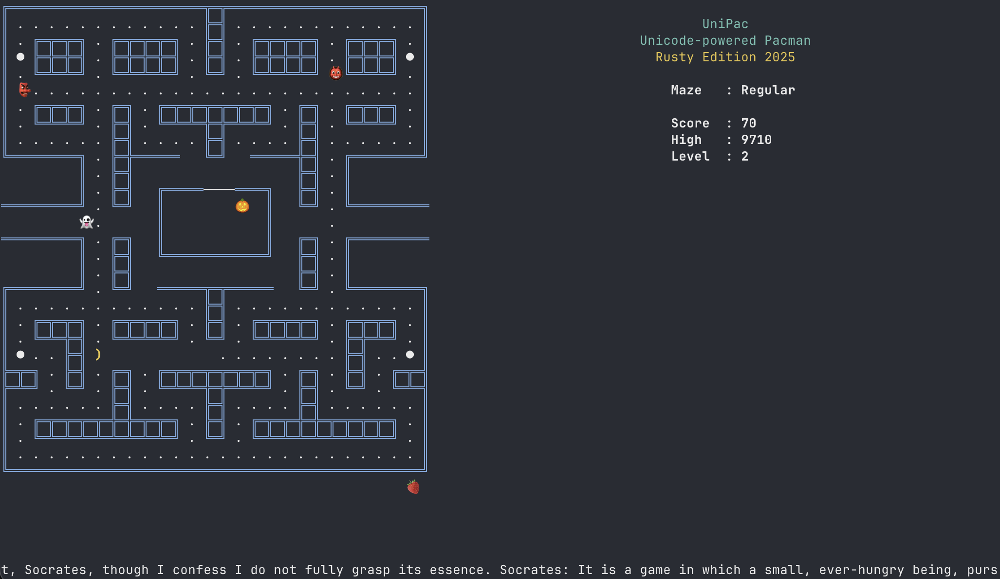

# UniPac: Unicode-powered pacman adventure 

Pacman for the terminal. 

Has most of the game elements from the original game:
* Ghosts alternate between 'scatter' (heads for their individual corners) and 'chase' (💡) periods.
* Ghosts flee pacman when frightened.
* Ghosts slow down in the tunnel and when frightened.
* When eaten, ghost eyes trace a path back to the ghost house.
* Two 'fruit' bonuses on every level.
* Cornering.

Mazes:
* Shortened pacman maze (24 rows).
* Regular pacman maze (29 rows).
* 4 Ms Pacman mazes (31 rows).

Pacman is animated with ascii symbols and the ghosts with unicode codepoints (Pinky 👺, Blinky 👹, Inky 👻, Clyde 🎃); 
 Unicode has symbols for most of the fruit bonuses (🍒,🍓,🍑,🍎,🍇,🚀,🔔,🔑), but not for the ghosts themselves.

## Controls

Arrow keys to steer, space to pause, q to quit.

## Build and run
```
  git clone https://github.com/jesper-olsen/UniPac
  cd UniPac
  cargo run --release   # run from the repo root: Audio/ is loaded relative to the current directory
```

 


## Credits

* Steven Goodwin's [C version](https://github.com/MarquisdeGeek/pacman) of the game.
* Sound assets from Dale Harvey's [JS version](https://github.com/daleharvey/pacman)
* Marquee text by [ChatGPT](https://chat.openai.com/)
* [The Pac-Man Dossier](https://pacman.holenet.info)
* [Ms Pac-Man Walkthrough](https://strategywiki.org/wiki/Ms._Pac-Man/Walkthrough)
